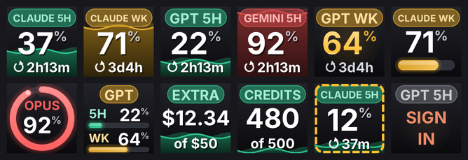
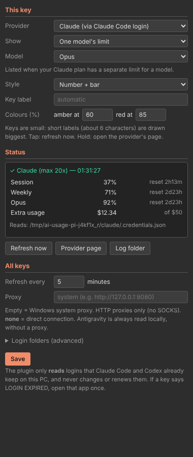

# AI Usage for StreamDock

See the usage limits of your AI subscriptions live on the LCD keys of a **Redragon SS-550** stream deck and other MiraBox *StreamDock*-based devices.

**Claude** · **ChatGPT (Codex)** · **Google Antigravity**


Each key shows one thing from one provider:

| Show | Claude | ChatGPT (Codex) | Antigravity |
|---|---|---|---|
| **5-hour limit** | ✓ | ✓ | ✓ per quota group (e.g. Gemini) |
| **Weekly limit** | ✓ | ✓ | ✓ per quota group |
| **One model's limit** | e.g. Opus, when your plan has one | extra Codex limits | per model (e.g. Gemini 3 Pro) |
| **Overview** (5-hour + weekly) | ✓ | ✓ | ✓ |
| **Extra usage / credits** | extra usage in $ | credits balance | prompt credits |

- **Tap** a key to refresh it now. **Hold** it (≥ 0.6 s) to open the provider's page.
- The colour follows usage: green, then amber at 60 %, then red at 85 %. Both thresholds can be changed per key.
- A dashed amber frame means the last refresh failed. The numbers shown are from the last successful refresh.
- Four styles: **Fill** (the default; liquid fills the key as you use it), **Big number**, **Number + bar** and **Ring**.

> **Unofficial.** This project is not affiliated with, endorsed by, or supported by Anthropic, OpenAI or Google. Claude, ChatGPT, Codex and Antigravity are trademarks of their respective owners.

## Read-only by design

The plugin **reads** usage with the logins that the providers' own apps already keep on your PC. It never asks for a password or cookie. It never stores a token, and it never changes, renews or uploads one.

| Provider | Where the numbers come from | You need |
|---|---|---|
| Claude | `%USERPROFILE%\.claude\.credentials.json` → `api.anthropic.com/api/oauth/usage`, the same data as `/usage` in Claude Code | [Claude Code](https://docs.claude.com/en/docs/claude-code/overview) signed in with a Pro or Max plan |
| ChatGPT | `%USERPROFILE%\.codex\auth.json` → `chatgpt.com/backend-api/codex/usage`, the same data as `/status` in Codex | [Codex](https://developers.openai.com/codex) (CLI, IDE or app) signed in with ChatGPT |
| Antigravity | The running Antigravity app's own local language server on `127.0.0.1`. No login file is read and nothing leaves your PC. | The Antigravity app open |

Access tokens expire. Claude Code and Codex renew them whenever you use those apps. If a key shows **LOGIN EXPIRED**, open that app once and the key recovers on its next refresh. The plugin deliberately doesn't renew tokens itself, because renewing would mean writing to another app's login file.

## Designed for tiny keys

The SS-550 shows each key at about 100 × 100 px on a ~14 mm screen. So every key image has at most three elements and uses bold type only. Text that doesn't fit is shrunk rather than clipped, and nothing is smaller than about 17 px on the device. Here are the same keys at real size:



Short custom labels (about 6 characters, e.g. `5H`, `OPUS`) are drawn biggest. Error details aren't crammed onto the key; they appear in the key's settings panel.

## Install

**Requirements:** Windows 10 or 11, plus the Redragon software for the SS-550 (or another MiraBox / HotSpot *StreamDock* build). Open that software at least once before installing.

1. Download **`AIUsage-Setup-<version>.exe`** from [Releases](../../releases) and run it.
   - It installs for your Windows user only and needs no administrator rights.
   - It closes the stream deck software for a moment, puts the plugin in place and starts the software again.
   - You can delete the setup file afterwards.
2. In the stream deck software, find the **AI Usage** category and drag the **AI Usage** action onto a key.
3. In the key's settings, choose the **Provider** and what to **Show**.

To uninstall, go to **Settings → Apps → Installed apps → AI Usage for StreamDock → Uninstall**.

### "Windows protected your PC" / unknown publisher

Windows SmartScreen warns about any new program that isn't code-signed with a certificate that has built up reputation. It warns even when nothing is wrong with the program. To continue, click **More info → Run anyway**.

You don't have to trust the binary. You can check it or build it yourself:
- Every release is built from this repository by [GitHub Actions](.github/workflows/build.yml), and its SHA-256 checksums are published next to it.
- The sources are a few hundred lines of plain C#. You can compile them yourself with the compiler that ships in Windows (see [Building](#building)).

The release workflow can sign the plugin and the installer once a code-signing certificate is added as a repository secret (see [CONTRIBUTING.md](CONTRIBUTING.md#code-signing)).

**Devices:** written for the Redragon SS-550 software. Other MiraBox StreamDock-family devices (MiraBox 293/293S/N3/N4, Ajazz, Soomfon …) use the same plugin SDK and should work, but are untested. macOS is not supported.

## What the keys say

| Key text | Meaning / fix |
|---|---|
| `...` | Loading |
| `SIGN IN` | No login was found for this provider. Install and sign in to Claude Code (`claude`, then `/login`) or Codex (`codex login`). |
| `LOGIN EXPIRED` | The saved login has expired. Open Claude Code or Codex once. |
| `NOT RUNNING` | Antigravity isn't open |
| `NO ANSWER` | Antigravity is open, but its language server didn't answer. Try again after it has fully started. |
| `NO PLAN` | The login has no plan with limits. For Codex this also covers being signed in with an API key instead of ChatGPT. |
| `OFFLINE` | Network or proxy problem |
| `BLOCKED` | The provider refused the request (HTTP 403). This is often temporary. |
| `WAIT` | Rate limited. The plugin backs off and retries on its own. |
| `N/A` | Your plan doesn't report this limit (for example, there's no separate limit for the model you typed) |

The **Status** box in the key settings shows the full message for the key's provider. The log is at `%APPDATA%\AIUsageDeck\plugin.log`.

## Settings panel



For **One model's limit**, and for Antigravity's quota groups, the settings list the models and groups your plan actually reports, so you can pick one from the dropdown. Antigravity must be open for its list to load. **Other** lets you type part of a name instead.

**All keys** settings:
- **Refresh every N minutes** (default 5). Very short intervals can get you rate-limited.
- **Proxy:** empty uses the Windows system proxy, `http://host:port` uses a specific HTTP proxy, and `none` connects directly.
- **Login folders**, only needed if you use `CLAUDE_CONFIG_DIR` / `CODEX_HOME` in a non-standard way.

## Privacy and security

- Network requests go only to `api.anthropic.com` (Claude) and `chatgpt.com` (ChatGPT), and to `127.0.0.1` for Antigravity.
- Login files are only read. Tokens are never written to the log, the settings file or the settings panel.
- Finding Antigravity means reading the command line of Antigravity's `language_server` process through WMI, which gives the port and local CSRF token. Its listening ports come from the Windows IP Helper API. No shell commands or scripts are run.
- The settings file `%APPDATA%\AIUsageDeck\config.json` contains no secrets.

## How it works

`AIUsage.exe` is a small C# program (.NET Framework 4.x, which ships with Windows) started by the stream deck software. It talks to the software over its local WebSocket, using the Elgato-compatible StreamDock plugin protocol, and draws each key as a 144 × 144 PNG with GDI+.

**None of the usage endpoints are documented public APIs.** They are what the providers' own apps use, and they may change without notice. The parsers accept the known response formats (for Claude, both the current `limits` array and the older flat format). If a provider breaks, please open an issue and attach the log, which contains no tokens.

## Building

```
src/                               C# sources (C# 5, compiled by Windows' own csc.exe)
  Plugin.cs                        host connection, per-provider refresh, key rendering decisions
  ClaudeProvider.cs                Claude via Claude Code's login
  CodexProvider.cs                 ChatGPT via Codex's login
  AntigravityProvider.cs           Antigravity via its local language server
  KeyRenderer.cs                   key images
  HostControl.cs                   closes / restarts the stream deck software for the installer
  Config.cs, Http.cs, Json.cs, Log.cs, Usage.cs, AssemblyInfo.cs
com.saeedsh.aiusage.sdPlugin/      the plugin folder: manifest, settings panel (pi.html / pi.js), icons
installer/                         NSIS installer script, icon and artwork
build.ps1                          builds AIUsage.exe and dist\AIUsage-Setup-<version>.exe
test/                              host + API emulator, settings-panel test, key image gallery
```

On Windows (install [NSIS](https://nsis.sourceforge.io) for the installer):
```powershell
powershell -ExecutionPolicy Bypass -File .\build.ps1
```

Tests run on Linux with Mono, which is what CI does. CI also builds and tests with the real `csc.exe` on Windows:
```bash
sudo apt-get install mono-devel libgdiplus nsis
pip install -r test/requirements.txt
./test/run-tests.sh
```

See [CONTRIBUTING.md](CONTRIBUTING.md).

## Credits

- Plugin protocol: [MiraBox StreamDock Plugin SDK](https://github.com/MiraboxSpace/StreamDock-Plugin-SDK).
- [knupson/streamdock-deck-tools](https://github.com/knupson/streamdock-deck-tools) showed that a plain `csc.exe`-built backend works with the Redragon software.
- [wakamex/clanker-usage](https://github.com/wakamex/clanker-usage) documents the Claude and Codex usage formats. [Henrik-3/AntigravityQuota](https://github.com/Henrik-3/AntigravityQuota) documents the Antigravity language server.

## License

[MIT](LICENSE) © 2026 SaeedSH
